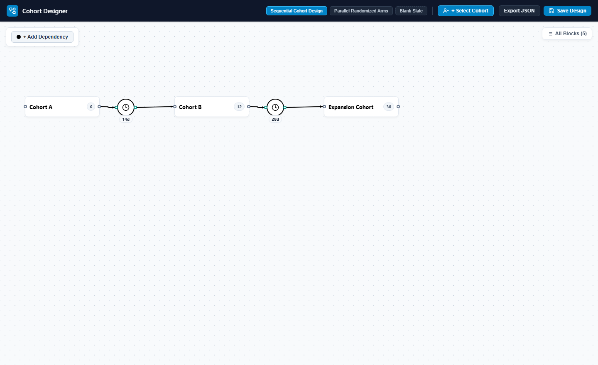
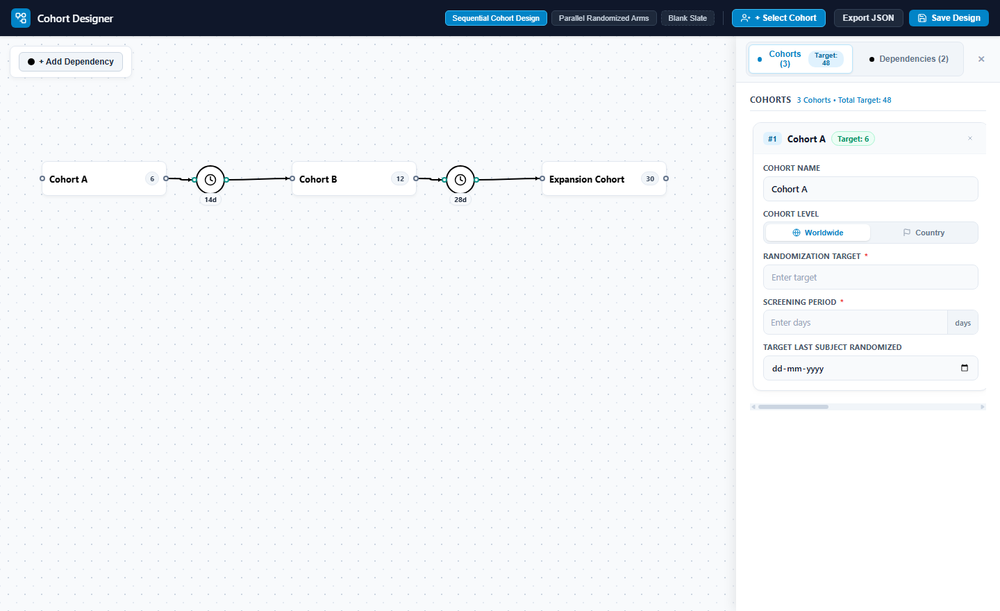
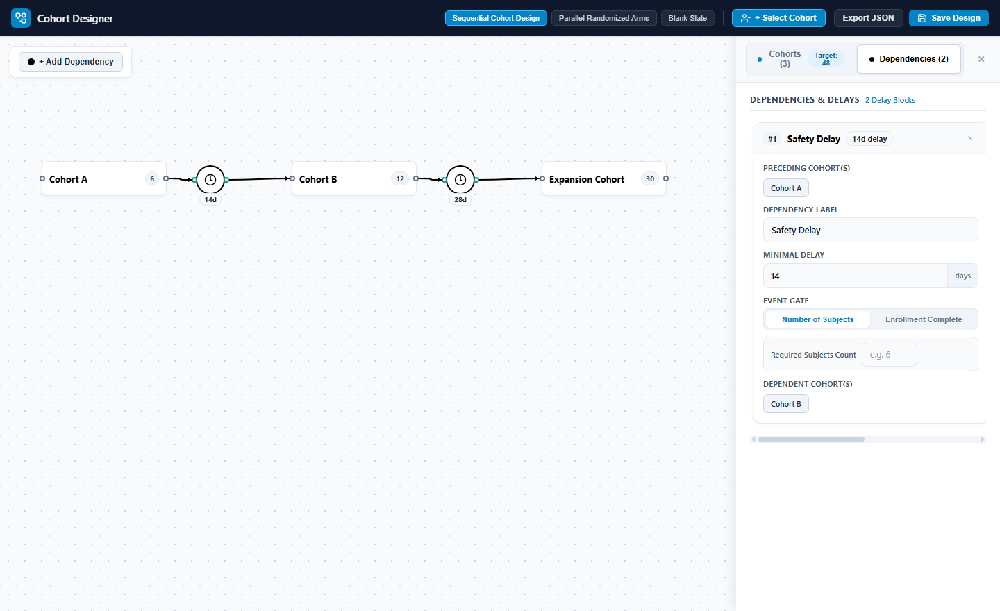

# ngx-cohort-designer

An interactive clinical trial cohort architecture designer component for Angular applications.

[](https://angular.dev/)
[](https://opensource.org/licenses/MIT)

---

## Overview



`ngx-cohort-designer` is an Angular component library for designing clinical study arms, cohorts, safety washout delays, and dependency gates. It features an interactive SVG canvas with bezier wiring, cycle detection, multi-node batch editing, and clean data export for clinical study databases and EDC integration.

---

## Sample Application Screenshots

### Canvas Architecture & Sequential Cohorts


### Cohorts Batch Inspector Panel
Side-by-side column layout for reviewing and editing all study cohorts simultaneously:


### Dependencies & Delay Gates
Dependency configuration showing preceding cohorts on top, minimal delay and event gate in between, and dependent cohorts at the bottom:


---

## Features

- **Minimal Cohort Blocks**
  - Displays cohort name, optional randomized subjects badge, and dynamic side-resize handles (140px to 700px width, 44px to 260px height).
  - Configurable parameters: Cohort Level (Worldwide / Country), Randomization Target, Screening Period (days), and Target Last Subject Randomized date.
  - Hover tooltips detailing cohort status, screening windows, and cutoff targets.
  - Integration with external study cohort selectors.

- **Dependency & Delay Gates**
  - Circular nodes (46px x 46px) featuring clinical delay iconography and duration badges.
  - Ordered inspector layout: Preceding Cohort(s) on top, delay parameters in the middle, and Dependent Cohort(s) at the bottom.
  - Event gate modes: Number of Subjects (with threshold count) or Enrollment Complete.

- **Directional Horizontal Connections**
  - Left (Input) and Right (Output) connector ports with smooth bezier curve routing.
  - Sleek, proportional black arrowheads that dock cleanly at port rims without visual overlap.
  - Clinical validation rules: blocks direct Cohort-to-Cohort connections (requiring an explicit delay or gate between cohorts) and prevents circular dependency cycles.
  - Drag-and-drop wire creation with instant canvas cancel on release.

- **Expandable Inspector Drawer**
  - Segmented toggle to switch between Cohorts and Dependencies.
  - Horizontal side-by-side column cards for simultaneous multi-block editing with synced sequencing (left-to-right canvas order).
  - Automatic single-block details view when clicking any node or connection on the canvas.

- **Programmatic Save & Load API**
  - `saveData(): CohortDesignFlow` and `getData(): CohortDesignFlow` export full protocol definitions in clean JSON.
  - `loadData(flow)` restores canvas layout, positions, parameters, and connections.

---

## Installation

### Option A: From Local `.tgz` Package
Copy the packaged archive `ngx-cohort-designer-0.1.0.tgz` to your project root, then run:

```bash
npm install ./ngx-cohort-designer-0.1.0.tgz
```

### Option B: From NPM Registry
```bash
npm install ngx-cohort-designer
```

---

## Usage Guide

`ngx-cohort-designer` is a standalone component, compatible with Angular 18 and Angular 19+.

### 1. In a Standalone Component

```typescript
import { Component, ViewChild } from '@angular/core';
import { CommonModule } from '@angular/common';
import { 
  CohortDesignerComponent, 
  CohortDesignFlow,
  PROTOCOL_TEMPLATES 
} from 'ngx-cohort-designer';

@Component({
  selector: 'app-study-designer',
  standalone: true,
  imports: [CommonModule, CohortDesignerComponent],
  templateUrl: './study-designer.component.html',
  styleUrls: ['./study-designer.component.scss']
})
export class StudyDesignerComponent {
  @ViewChild('designer') designer!: CohortDesignerComponent;

  // Initialize with a template or empty canvas
  protocolFlow: CohortDesignFlow = PROTOCOL_TEMPLATES[0].flow;

  onFlowChange(flow: CohortDesignFlow) {
    console.log('Canvas flow updated:', flow);
  }

  saveProtocol() {
    const savedData: CohortDesignFlow = this.designer.saveData();
    console.log('Saved protocol data:', savedData);
  }
}
```

### 2. In an NgModule-based Component

```typescript
import { NgModule } from '@angular/core';
import { BrowserModule } from '@angular/platform-browser';
import { CohortDesignerComponent } from 'ngx-cohort-designer';
import { MyStudyComponent } from './my-study.component';

@NgModule({
  declarations: [MyStudyComponent],
  imports: [
    BrowserModule,
    CohortDesignerComponent
  ]
})
export class MyStudyModule {}
```

### 3. Component Template

```html
<div class="study-editor-container">
  <div class="editor-header">
    <h2>Clinical Study Arm & Cohort Designer</h2>
    <button type="button" class="btn-save" (click)="saveProtocol()">
      Save Protocol Design
    </button>
  </div>

  <div class="designer-canvas-wrapper">
    <lib-cohort-designer
      #designer
      [flowData]="protocolFlow"
      [readonly]="false"
      (flowChange)="onFlowChange($event)"
    ></lib-cohort-designer>
  </div>
</div>
```

### 4. Container Styles

Ensure the canvas host container has an explicit height:

```scss
.study-editor-container {
  display: flex;
  flex-direction: column;
  width: 100%;
  height: 100vh;
  box-sizing: border-box;
}

.editor-header {
  display: flex;
  justify-content: space-between;
  align-items: center;
  padding: 12px 20px;
  background: #ffffff;
  border-bottom: 1px solid #e2e8f0;

  h2 {
    margin: 0;
    font-size: 18px;
    font-weight: 700;
    color: #0f172a;
  }

  .btn-save {
    padding: 8px 16px;
    background: #0284c7;
    color: #ffffff;
    border: none;
    border-radius: 6px;
    font-size: 13px;
    font-weight: 600;
    cursor: pointer;
  }
}

.designer-canvas-wrapper {
  flex: 1;
  position: relative;
  overflow: hidden;
}
```

---

## Component API Reference

### Selector
`<lib-cohort-designer>`

### Inputs

| Input | Type | Default | Description |
| :--- | :--- | :--- | :--- |
| `[flowData]` | `CohortDesignFlow` | `undefined` | Initial protocol design flow data to load onto canvas. |
| `[readonly]` | `boolean` | `false` | When true, disables card additions, side resizing, deletions, and wire dragging. |
| `[customIcons]`| `IconOption[]` | `[]` | Optional custom SVG icons to append to the delay icon gallery. |

### Outputs

| Output | Event Payload | Description |
| :--- | :--- | :--- |
| `(flowChange)` | `CohortDesignFlow` | Emitted whenever any block, dimension, position, wire, or parameter is modified. |
| `(save)` | `CohortDesignFlow` | Emitted whenever `designer.saveData()` is called. |
| `(nodeSelected)` | `FlowNode \| null` | Emitted when a node is selected or deselected. |
| `(connectionSelected)` | `Connection \| null` | Emitted when a connection wire is clicked or deselected. |

### Public Methods (Callable via `@ViewChild`)

```typescript
// Gathers all cohort data, custom card dimensions, parameters, dependencies, and connections
const flow: CohortDesignFlow = this.designer.saveData();

// Retrieves the current live flow state without triggering save event
const flow: CohortDesignFlow = this.designer.getData();

// Loads an existing protocol design definition
this.designer.loadData(existingFlow);

// Clears the canvas
this.designer.clear();

// Programmatically adds a new cohort block at coordinates (x, y)
this.designer.addCohort(x, y);

// Programmatically adds a new dependency block at coordinates (x, y)
this.designer.addDependency(x, y, 'clock');

// Opens the side inspector panel on a given section
this.designer.openOverview('cohorts');
```

---

## Data Schema (`CohortDesignFlow`)

The JSON structure exported by `saveData()`:

```json
{
  "version": "1.0.0",
  "nodes": [
    {
      "id": "coh-1",
      "type": "cohort",
      "name": "Cohort A",
      "cohortLevel": "Worldwide",
      "randomizationTarget": 6,
      "screeningPeriod": 14,
      "targetLastSubjectRandomized": "2026-06-30",
      "subjects": 6,
      "width": 180,
      "height": 50,
      "x": 60,
      "y": 260
    },
    {
      "id": "dep-1",
      "type": "dependency",
      "name": "Safety Delay",
      "days": 14,
      "event": "Number of Subjects",
      "eventSubjectCount": 6,
      "icon": "clock",
      "x": 280,
      "y": 262
    },
    {
      "id": "coh-2",
      "type": "cohort",
      "name": "Cohort B",
      "cohortLevel": "Worldwide",
      "randomizationTarget": 12,
      "screeningPeriod": 14,
      "targetLastSubjectRandomized": "2026-08-31",
      "subjects": 12,
      "width": 180,
      "height": 50,
      "x": 420,
      "y": 260
    }
  ],
  "connections": [
    {
      "id": "conn-1",
      "fromNodeId": "coh-1",
      "fromPort": "right",
      "toNodeId": "dep-1",
      "toPort": "left"
    },
    {
      "id": "conn-2",
      "fromNodeId": "dep-1",
      "fromPort": "right",
      "toNodeId": "coh-2",
      "toPort": "left"
    }
  ]
}
```

---

## Development & Build Commands

### Run Dev Server
```bash
npm start
```
Runs the host application at `http://localhost:4200`.

### Run Unit Tests
```bash
npx ng test ngx-cohort-designer --watch=false --browsers=ChromeHeadless
```

### Build Package
```bash
npm run build:lib
```

### Package into `.tgz`
```bash
npm run pack:lib
```

---

## License

MIT
